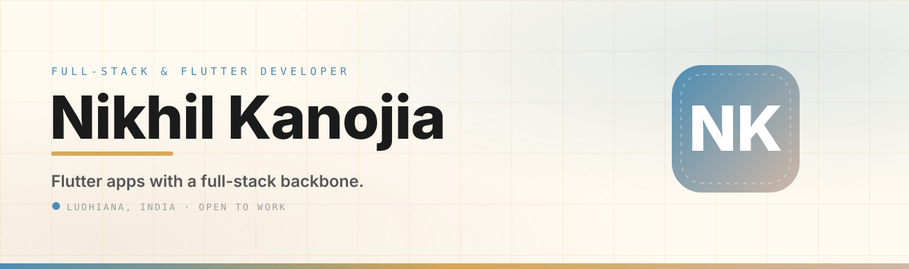
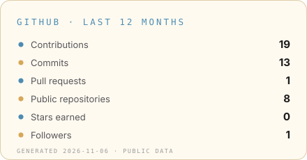

  

 

  
  
  
  
   
  

 

> **Currently** — Flutter Developer Intern @ Digiverse Technologies (Feb–Jun 2026) · Open to internships, freelance work and full-time roles in Flutter, full-stack web and product design.

## About Me

I'm **Nikhil Kanojia**, an MCA graduate (CGPA **9.69**) from Guru Nanak Dev Engineering College, Ludhiana — a full-stack mobile & web developer who ships complete products, from interface to infrastructure.

I build **cross-platform Flutter apps**, **secure REST APIs** and **ecommerce experiences** end-to-end: role-based access, JWT authentication, payment & fulfillment integrations (Cashfree + Shiprocket) and transactional email. On the side, I bring hands-on **UI design and branding** experience — so I can move between interface decisions, backend structure and launch polish without losing the product thread.

- Building [**PeakLethics.com**](https://peaklethics.com) — an admin-managed ecommerce storefront where the business updates products & content without a developer
- Built the **GNDEC Academic Notice Portal** — real-time notices for students with role-based access (Admin / Faculty / Student) and JWT auth
- Winner of **college-level presentation competition** · **5th rank**, Panjab University (BCA Sem 1) · Executive Member, **Training & Placement Cell, GNDEC** (2025–26)

## Tech Stack

  
  
  
  
  
  
  
  
  
  
  
  
  
  
  
  

## Featured Projects

| Project | Stack | What it does |
| --- | --- | --- |
| **[PeakLethics.com](https://peaklethics.com)** — Full-stack ecommerce | Next.js · Node.js · MySQL · Cashfree · Shiprocket | Admin-managed storefront; products & content update without a developer. Automated fulfillment, shipment tracking, payments and transactional email. |
| **GNDEC Academic Notice Portal** — Full-stack mobile | Flutter · Node.js · MySQL · JWT | Real-time academic notice delivery for students with role-based access control (Admin / Faculty / Student). |
| **Task Manager App** — Cross-platform | Flutter · Node.js · Express · MySQL | Priorities, deadlines, role-based access and real-time status updates behind a secure JWT-authenticated REST API. |
| **CosmicCreateHub** — Web platform | JavaScript · HTML5 · CSS3 · WebRTC | Eight interactive tools including browser-based WebRTC voice calling and real-time API integrations. |
| **[NetSpeed-Monitor](https://github.com/nikhil9160/NetSpeed-Monitor)** — Desktop widget | Python | Network speed monitor widget for Windows. |
| **[Portfolio](https://nikhil9160.github.io/Portfolio/)** — Personal site | HTML · CSS · JavaScript | Responsive portfolio with interactive details, resume download and project showcase. |

## Experience

- **Flutter Developer Intern** — Digiverse Technologies, Ludhiana · *Feb–Jun 2026* — Engineered 2+ cross-platform Flutter apps in Dart with a reusable widget architecture.
- **Full-Stack Developer Intern** — Science & Technology Entrepreneurs' Park (STEP), GNDEC · *Jan–Jul 2026* — Structured training in building and testing full-stack web applications.
- **Web & Graphic Designer** — Aros4Perfumes · *Jun 2025 – Present* — Built the company ecommerce website from scratch (new digital sales channel) and created branding/packaging graphics that increased market visibility.

## Education

- **MCA** — Guru Nanak Dev Engineering College / I.K. Gujral Punjab Technical University · 2024–2026 · **CGPA 9.69**
- **BCA** — Kamla Lohtia SD College / Panjab University · 2021–2024 · **87.27%**

## GitHub Stats

  
  
   
  

## Contact

  
  
  
  

 

  Thanks for visiting — open to interesting problems and good teams.

